<i>An AI-powered multimodal assistive application for people with <b>Mild Cognitive Impairment (MCI)</b>.</i>

People living with MCI struggle with everyday memory tasks: remembering appointments and medication,
finding misplaced objects, recognising familiar people, and recalling recent conversations. Existing
support is spread across many disconnected apps, and caregivers have little visibility into how the
person they care for is doing.

MindNest is a single, privacy-preserving companion that combines smartphone capture (camera, audio, GPS)
with AI processing on a backend/local node to provide:

read as text

- **Routine support** — daily schedule, appointments, reminders and medication reminders
- **Object finding** — object detection and tracking that reports the *last observed* location of an item
- **Familiar-person recognition** — face recognition of people registered by the caregiver
- **Conversational memory** — speech-to-text, embeddings and RAG to recall past conversations in context
- **Personal AI assistant** — answers questions using the patient's schedule, data and retrieved memories
- **Safety** — GPS geofencing with caregiver alerts
- **Well-being** — relaxation, meditation and therapeutic audio
- **Caregiver dashboard** — patient management, monitoring, notifications and activity logs

> [!NOTE]
> The system states uncertainty instead of guessing. It never diagnoses, never changes medication or
> dosage, and never claims an identity or location it is not confident about.

| Actor | Role | Primary needs |
|---|---|---|
| **Patient** | Primary end user | Simple, low-cognitive-load assistance: reminders, memory cues, object finding, familiar-person recognition, schedule and conversational support |
| **Caregiver** | Remote support and configuration | Patient status, schedules, medications, safe zones, alerts, familiar-person registration, activity information |
| **AI/Backend System** | Processing layer | Receive multimodal input, run AI services, retrieve data, generate responses, trigger actions |
| **Notification Service** | Delivery mechanism | Deliver reminders, alerts and emergency notifications |

- **Mobile app** (`mobile/`): one Expo / React Native app with separate patient and caregiver experiences
- **Backend** (`backend/`): Django + Django REST Framework, JWT authentication, role-based access control
- **AI**: local face recognition (OpenCV YuNet + SFace) and text embeddings; Gemini for assistant responses,
  room-scan object detection and speech-to-text (demo data only, see [docs/AI_USAGE.md](docs/AI_USAGE.md))

See [docs/SETUP.md](docs/SETUP.md).

| Document | Location |
|---|---|
| Consolidated specification | [docs/specs/00_Consolidated_Specification.html](docs/specs/00_Consolidated_Specification.html) |
| Requirements, design, database, API, UI/UX, AI/RAG specs | [docs/specs/](docs/specs/) |
| Project milestones | [docs/Project_Milestones.html](docs/Project_Milestones.html) |
| UI wireframes | [docs/wireframes/](docs/wireframes/) |
| Setup guide | [docs/SETUP.md](docs/SETUP.md) |
| Architecture decisions | [docs/adr/](docs/adr/) |
| Spec consistency analysis | [docs/analysis/consistency-matrix.md](docs/analysis/consistency-matrix.md) |
| Requirements traceability | [docs/requirements/TRACEABILITY.md](docs/requirements/TRACEABILITY.md) |
| Current project state | [docs/PROJECT_STATE.md](docs/PROJECT_STATE.md) |
| Known issues | [docs/KNOWN_ISSUES.md](docs/KNOWN_ISSUES.md) |
| Phase reports | [docs/phase-reports/](docs/phase-reports/) |

